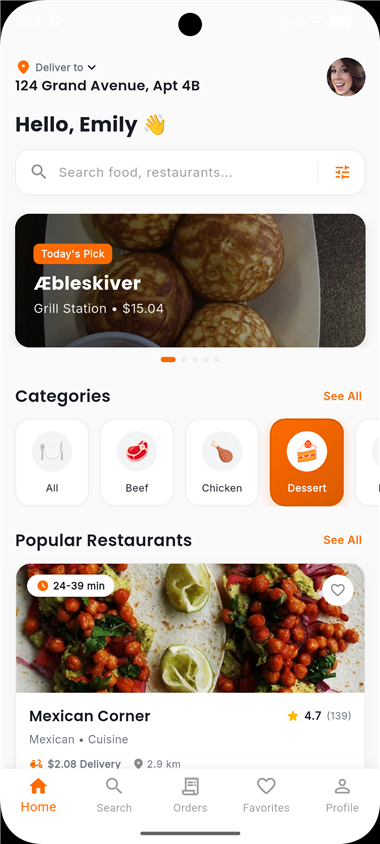
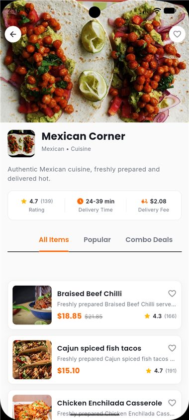
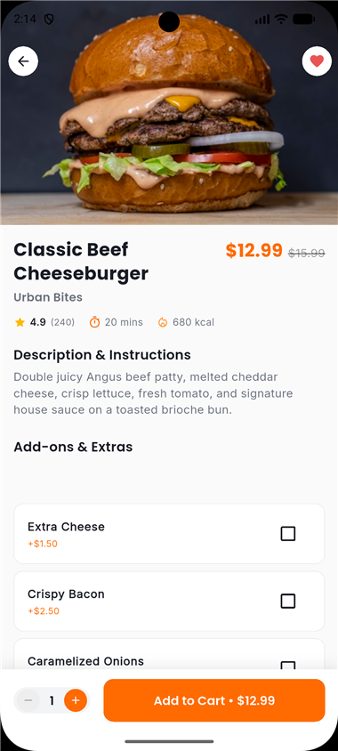
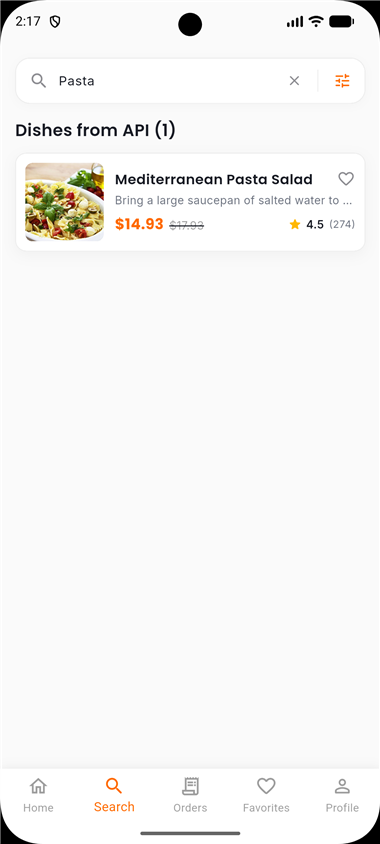
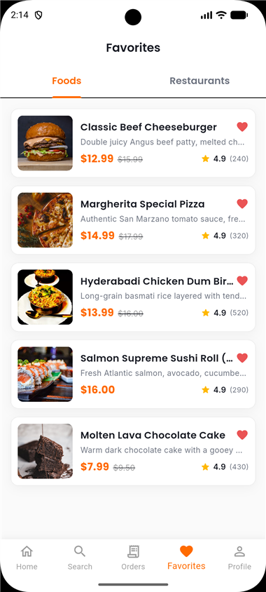
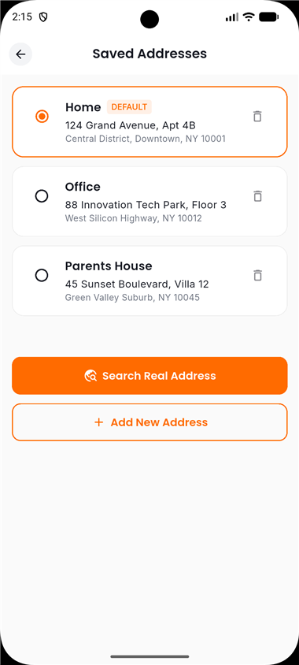
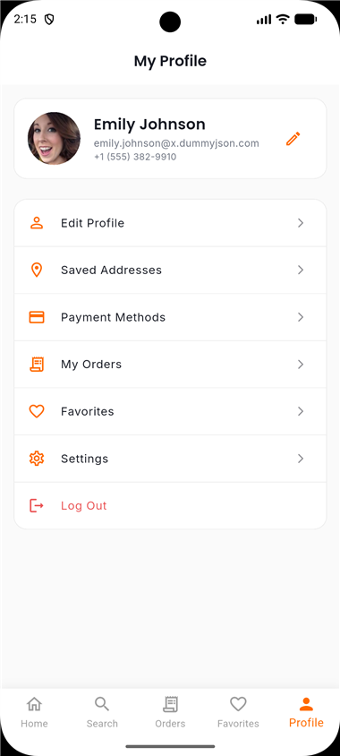
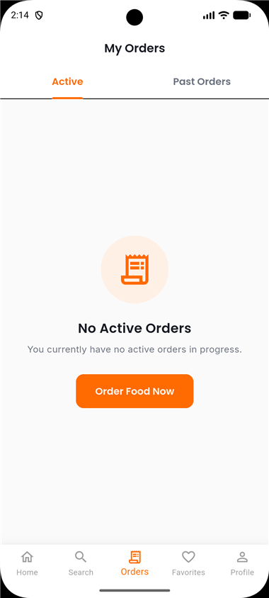

# rimrid_delivery

A Flutter food-delivery app built entirely on free, keyless public APIs — real meals, real cuisines, real auth, real delivery-driver identities, and real address search, wrapped in a polished food-delivery UI.

## Screenshots

<table>
  <tr>
    <td align="center" width="25%">
      <br/>
      <b>Home</b><br/>
      Real food banner, categories & restaurants
    </td>
    <td align="center" width="25%">
      <br/>
      <b>Restaurant Details</b><br/>
      Cuisine-based restaurant with a real menu
    </td>
    <td align="center" width="25%">
      <br/>
      <b>Food Details</b><br/>
      Real recipe, price, add-ons
    </td>
    <td align="center" width="25%">
      <br/>
      <b>Search</b><br/>
      Live results from the API
    </td>
  </tr>
  <tr>
    <td align="center" width="25%">
      <br/>
      <b>Favorites</b><br/>
      Save foods & restaurants
    </td>
    <td align="center" width="25%">
      <br/>
      <b>Addresses</b><br/>
      Real address search & geocoding
    </td>
    <td align="center" width="25%">
      <br/>
      <b>Profile</b><br/>
      Real login & avatar photo
    </td>
    <td align="center" width="25%">
      <br/>
      <b>Orders</b><br/>
      Order history & live tracking
    </td>
  </tr>
</table>

## Features

- **Browse & search real food** — categories, dishes, and recipes pulled live from TheMealDB
- **Cuisine-based restaurants** — built from TheMealDB's cuisine areas (Italian, Mexican, Japanese, and more), each with a real menu
- **Cart & checkout** with promo codes, delivery fee, and tax breakdown
- **Real authentication** — login/register against a live auth API, with a real portrait avatar
- **Live order tracking** with a real, randomly generated delivery-driver identity per order
- **Favorites** for both foods and restaurants
- **Real address search** — geocoded address lookup when adding a delivery address
- **Order history**, saved addresses, and payment methods

## Free APIs used

| API | Used for |
|---|---|
| [TheMealDB](https://www.themealdb.com/api.php) | Categories, dishes, recipes, search, and cuisine-based restaurants |
| [DummyJSON](https://dummyjson.com/) | Real login/register HTTP flow |
| [randomuser.me](https://randomuser.me/) | Delivery-driver identity per order, and the user's profile photo |
| [OpenStreetMap Nominatim](https://nominatim.org/) | Real address search/geocoding |

All four are free and require no API key.

## Tech stack

- **Flutter** with the **Provider** state management pattern
- **go_router** for navigation
- **Dio** for networking, with a shared interceptor-based client per API
- **cached_network_image** for image loading/caching

## Getting started

```bash
flutter pub get
flutter run
```

The login screen comes pre-filled with demo credentials (DummyJSON only accepts its own seed accounts), so you can sign in immediately.
